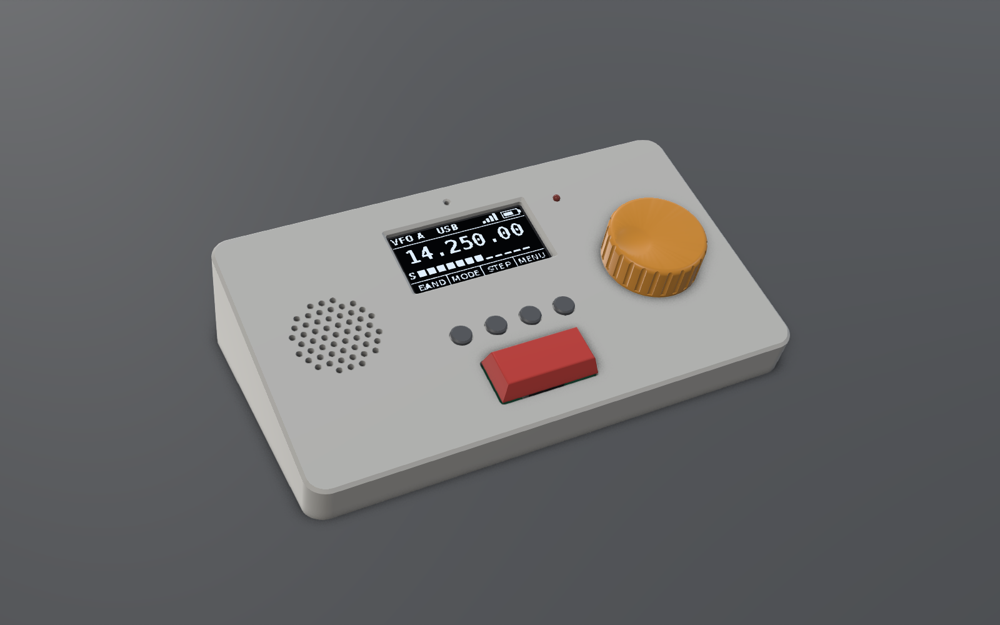
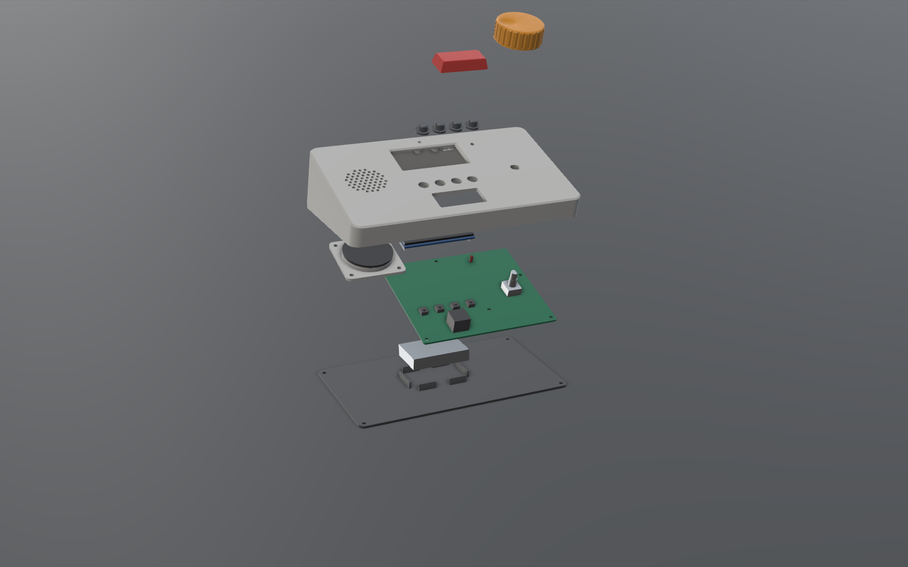
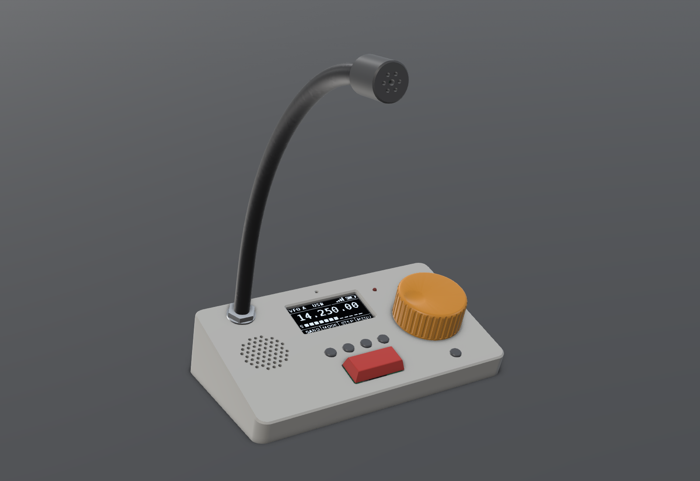
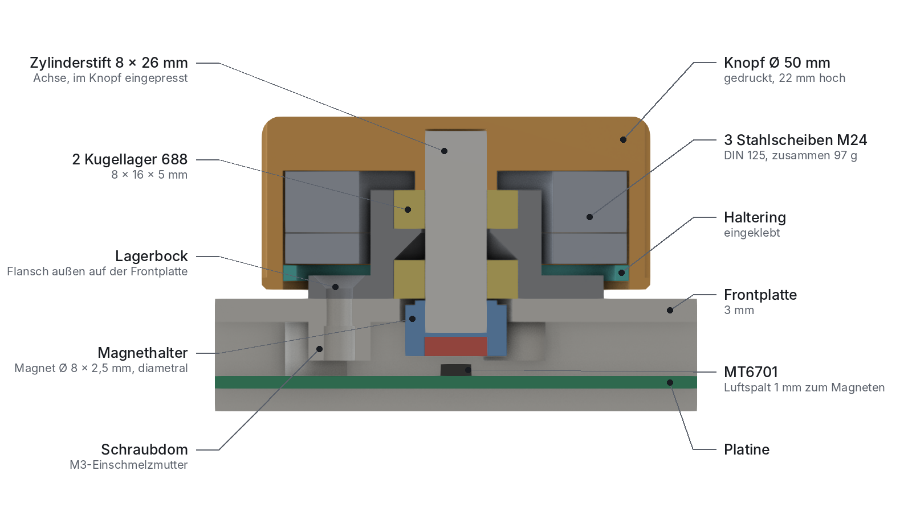

# Funkpult – WLAN-Bedieneinheit für den Funkgeräte-Server

Pultgerät mit PTT-Taste, Mikrofon, VFO-Drehknopf, vier Softkeys, Lautsprecher und OLED, das per
WLAN am Funkgeräte-Server hängt. Die Bedieneinheit ist ein dünner Client: Der Server entscheidet,
was Softkeys und Drehknopf gerade tun.



> **Stand:** Entwurf 0.2, 18.11.2026. Nichts davon ist gebaut oder gedruckt. Schaltplan und
> Gehäuse liegen vor, Platinenlayout und Firmware fehlen noch.

| Standard | Variante mit Schwanenhals und Schwungrad |
| --- | --- |
|  |  |

## Projektstruktur

```
.
├── elektronik/          Schaltplan (KiCad 7), PDF, Stückliste, Netzliste
│   └── quellen/         Python-Generator für Schaltplan, Netzlistenprüfung und Stückliste
├── gehaeuse/            Gehäuse (CadQuery)
│   ├── funkpult_cad.py  parametrisches Modell
│   ├── pcb_dxf.py       erzeugt platine_mechanik.dxf (Platinenumriss, Bohrungen, Bauteilpositionen)
│   ├── stl/  step/      Druckteile des Standardgehäuses
│   ├── variante/        Teile für Schwanenhals und Schwungrad
│   └── bilder/          Renderings und Schnittbild
└── docs/                Projektübersicht (funkpult-bedieneinheit.md), Präsentationsvideo
```

Einzelheiten stehen in den Unterordnern:

- [`elektronik/README.md`](elektronik/README.md): Bestückung, Ausführungen, Hinweise zum Layout
- [`gehaeuse/README.md`](gehaeuse/README.md): Druckteile, Druckeinstellungen, Kaufteile,
  Zusammenbau, Maße zum Nachmessen

## Festgelegt

- **Bauform:** Pultgehäuse, 18° geneigt, 190 × 118 mm Standfläche, 3D-Druck, Frontplatte auf dem Druckbett
- **Controller:** ESP32-S3-WROOM-1-N8R2, natives USB zum Flashen. Firmware in Rust geplant, existiert noch nicht
- **Strom:** LiPo 103450 mit 2000 mAh, Laden über USB-C (MCP73832, 300 mA), Lastumschaltung, AP2112K-3.3
- **Audio:** I2S-MEMS-Mikrofon ICS-43434, Verstärker MAX98357A, Lautsprecher Ø 40 mm
- **Anzeige:** Waveshare 2,42-Zoll-OLED, SSD1309, SPI
- **Bedienung:** MX-Schalter mit 2u-Kappe als PTT, Bourns PEC11R als Drehgeber, vier Taster, Duo-LED
- **Platine:** eigene Platine in KiCad, 118 × 101 mm, SMD unten, Bedienelemente oben. Eine Platine
  für alle Ausführungen

## Variante (0.2)

- **Schwanenhals:** zweites I2S-Mikrofon (INMP441-Modul) in gedruckter Kapsel an einem Hals mit
  M10 × 1, Stecker J7. Einbaumikrofon im linken, Schwanenhals im rechten Kanal desselben I2S-Busses.
- **Schwungrad-Knopf:** Ø 50 mm mit drei Stahlscheiben M24 (97 g) auf zwei Kugellagern 688, läuft
  nach einem Schubs aus. Kein Motor. Abtastung berührungslos mit Magnet Ø 8 × 2,5 mm und MT6701
  (U6) statt des Rast-Drehgebers. Taste SEL (SW9) ersetzt dessen Taster.
- Ein Motor (BLDC mit Feldregelung) wäre nur für per Software schaltbare Rastung nötig und ist
  nicht eingeplant.



## GPIO-Belegung (Kurzfassung)

| Funktion | GPIO |
| --- | --- |
| PTT, Taste SEL bzw. Drehgeber-Taster | IO4, IO5 |
| Drehgeber A/B bzw. MT6701 A/B oder I2C | IO6, IO7 |
| Display RST, DC, CS, MOSI, SCK | IO8 bis IO12 |
| LED TX, LED BUSY | IO13, IO14 |
| Softkeys F1 bis F4 | IO15 bis IO18 |
| USB D−/D+ | IO19, IO20 |
| Mikrofon WS, SCK, SD | IO38, IO39, IO40 |
| Verstärker BCLK, LRCLK, DIN, Enable | IO41, IO42, IO47, IO48 |
| Akkuspannung, USB-Erkennung, Ladestatus | IO1, IO2, IO21 |

## Protokoll FPP/1 (Kurzfassung)

- Eine WebSocket-Verbindung `ws://<server>:<port>/funkpult/v1`, Subprotokoll `fpp.v1`, Dienst per mDNS `_funkpult._tcp`
- JSON-Textframes: `hello`, `enc`, `key`, `ptt`, `stat` von der Bedieneinheit; `welcome`, `state`, `ui`, `menu`, `err` vom Server
- Binärframes mit 8 Byte Kopf (type, flags, seq, ts) für Audio. Standard PCM 16 Bit, 16 kHz, 20 ms, Opus optional
- PTT-Sicherheit: Der Server tastet ab, wenn Audioframes länger als `ptt_timeout_ms` (300) ausbleiben,
  bei Verbindungsabbruch und nach `tot_s` (180)

## Schnellstart

**Gehäuse drucken:** Die STL-Dateien in `gehaeuse/stl/` und `gehaeuse/variante/stl/` sind bereits
in Drucklage ausgerichtet. Welche Teile du für welche Ausführung brauchst, steht in
[`gehaeuse/README.md`](gehaeuse/README.md).

**Schaltplan ansehen:** [`elektronik/funkpult_schaltplan.pdf`](elektronik/funkpult_schaltplan.pdf).
Zum Bearbeiten `elektronik/funkpult.kicad_pro` in KiCad 7 oder neuer öffnen.

**Dateien neu erzeugen:**

```sh
# Gehäuse (CadQuery 2.x, ezdxf)
pip install cadquery ezdxf
python3 gehaeuse/funkpult_cad.py ausgabe/                               # Standard
python3 gehaeuse/funkpult_cad.py ausgabe/ --schwanenhals --schwungrad   # Variante
python3 gehaeuse/pcb_dxf.py ausgabe/

# Schaltplan (braucht die KiCad-Symbolbibliotheken unter /usr/share/kicad/symbols)
python3 elektronik/quellen/gen_funkpult.py ausgabe/
kicad-cli sch export netlist --format kicadsexpr -o ausgabe/funkpult.net ausgabe/funkpult.kicad_sch
python3 elektronik/quellen/check_netlist.py ausgabe/
python3 elektronik/quellen/make_bom.py ausgabe/
```

Erzeugte Dateien landen in `ausgabe/`. Git ignoriert diesen Ordner.

## Geprüft und offen

- **Geprüft:** Netzliste aus KiCad stimmt Pin für Pin mit der Soll-Netzliste überein
  (83 Positionen, 56 Netze). Gehäuse in vier Ausführungen ohne Durchdringung, alle STL-Netze geschlossen.
- **Offen:** ERC in KiCad, Layout der Platine, Firmware, Serverseite des Protokolls.
- **Nachmessen:** Display (Lage der aktiven Fläche, Dicke), Lautsprecherrand, Schiebeschalter.
- **Variante:** Pegel am MODE-Pin des MT6701 und Auflösung ab Werk im Herstellerdatenblatt klären.
  Presssitz der Achse, Lagersitze, Gewinde der Mikrofonkapsel und Standsicherheit mit Hals erproben.

## Lizenz

Copyright © 2026 Charly

Dieses Projekt (Schaltplan, Gehäuse, Druckdateien und Generator-Skripte) steht unter der
[CERN Open Hardware Licence Version 2 – Strongly Reciprocal](LICENSE) (CERN-OHL-S-2.0).
Wer ein Produkt aus diesen Quellen weitergibt oder verkauft, muss die geänderten Quellen unter
derselben Lizenz veröffentlichen.

Source Location: https://github.com/artmanns/rm-funkpult

Diese Quellen werden ohne jede ausdrückliche oder stillschweigende Gewährleistung bereitgestellt,
einschließlich der Marktgängigkeit, der zufriedenstellenden Qualität und der Eignung für einen
bestimmten Zweck. Die Bedingungen stehen in der CERN-OHL-S v2.
